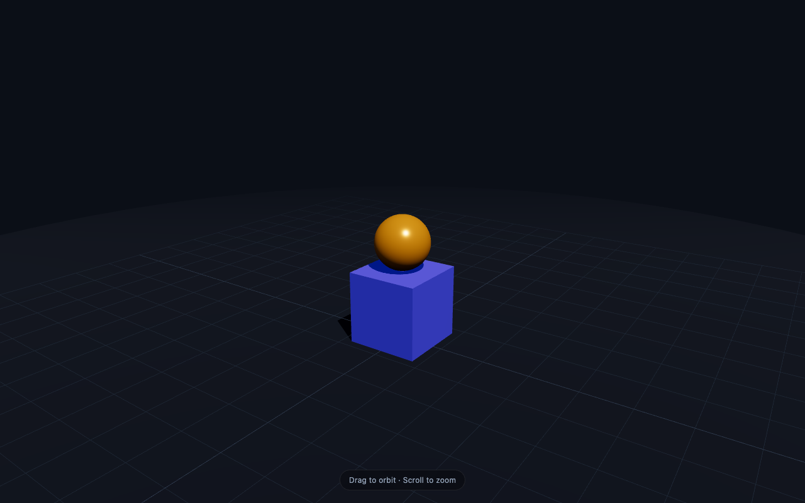

# Wall Breaker

A minimal [three.js](https://threejs.org/) + [Rapier](https://rapier.rs/) physics demo.
A sphere drops onto a cube, and both are simulated as rigid bodies.

The repository started empty, so this Vite + TypeScript app is its first project.



## Requirements

- Node.js 22 (`.nvmrc` included)
- npm

## Getting started

```bash
npm install
npm run dev
```

Open the URL Vite prints, usually http://localhost:5173.

## Scripts

| Command | Description |
| --- | --- |
| `npm run dev` | Start the Vite dev server |
| `npm run build` | Type-check, then build for production |
| `npm run preview` | Serve the production build |
| `npm run typecheck` | Type-check only |

## Project structure

```
index.html          app shell and canvas container
src/main.ts         renderer, camera, lights and the frame loop
src/physics.ts      Rapier world, rigid bodies and mesh syncing
src/style.css       full-screen layout
```

## How it works

- `main.ts` builds the scene: a ground plane, an indigo cube and an amber sphere.
- `physics.ts` starts Rapier, then creates three bodies: a fixed ground, a dynamic
  cube and a dynamic sphere spawned 4 m above the cube's top.
- Each frame calls `physics.update(delta)`. It accumulates frame time and steps
  the world in fixed 1/60 s slices, so the simulation runs at a stable speed.
- After stepping, the cube and sphere meshes copy their position and rotation
  from the rigid bodies.
- The app uses `@dimforge/rapier3d-compat`, which inlines the WebAssembly build.
  That keeps the Vite setup to zero extra WASM configuration, at the cost of a
  larger bundle.

## Versions

| Package | Version |
| --- | --- |
| three | 0.187.0 |
| @dimforge/rapier3d-compat | 0.21.0 |
| vite | 8.4.0 |
| typescript | 7.0.2 |
